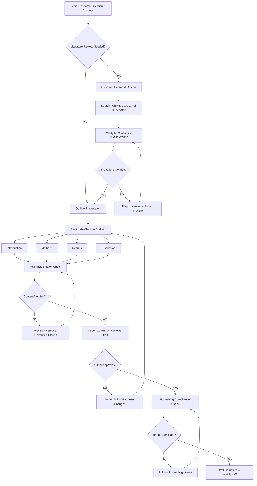

# Workflow 01: Manuscript Preparation

## Overview

This workflow guides AI-assisted manuscript preparation from initial concept through complete draft, with built-in safeguards against hallucination, fabrication, and ethical violations.

**Primary Agent**: Author Agent
**Supporting Agents**: Integrity Agent (citation verification)
**Quality Gates**: STOP-01 (content approval)

---

## Workflow Diagram

---

## Steps

### Step 1: Literature Review
See: `literature-review.md`

- Conduct systematic literature search using PubMed, CrossRef, OpenAlex
- Verify every identified reference (invoke `skills/citation-verification.md`)
- Build a verified reference library before drafting begins
- Flag knowledge gaps for the researcher

### Step 2: Outline and Structure
- Determine manuscript type (original research, review, case study, etc.)
- Apply appropriate structure (IMRAD for original research, PRISMA for systematic reviews)
- Identify required sections for the target journal
- Plan figure and table placement

### Step 3: Section-by-Section Drafting
See: `drafting.md`

- Draft each section with anti-hallucination guards active
- AI assists with language, structure, and clarity — NOT with generating claims or data
- Every factual claim must be traceable to a verified source or the author's own data
- Author provides core content; AI refines expression

### Step 4: Anti-Hallucination Verification
- Scan all drafted text for claims without citations
- Verify all in-text citations match the reference list
- Check for common hallucination patterns (see `rules/citation-integrity.md`)
- Flag any content that cannot be traced to a verified source

### Step 5: Author Review (STOP-01)
- Present complete draft to author for review
- Author must verify all content, especially AI-assisted sections
- Author takes full responsibility for all claims and citations
- **This is a STOP gate — cannot proceed without author approval**

### Step 6: Formatting Compliance
See: `formatting-compliance.md`

- Check against target journal requirements (from `config/journal-requirements.yaml`)
- Verify word count, abstract structure, heading levels, reference style
- Auto-format where possible; flag issues that require author decision

---

## Sub-Files

| File | Purpose |
|---|---|
| `drafting.md` | AI-assisted drafting procedures and guardrails |
| `literature-review.md` | Systematic search and citation verification procedures |
| `formatting-compliance.md` | Journal-specific formatting checks |

---

## Skills Used

- `skills/citation-verification.md` — Verify all references
- `skills/readability-analysis.md` — Check draft readability
- `skills/prisma-compliance.md` — If systematic review
- `skills/statistical-review.md` — Check methods section

---

## Rules Applied

- `rules/ai-ethics.md` — AI cannot author content; human accountability
- `rules/citation-integrity.md` — Every citation must be verified
- `rules/quality-gates.md` — STOP-01 must be cleared
