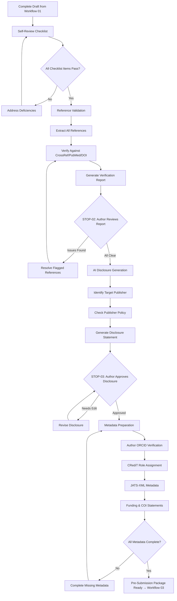

# Workflow 02: Pre-Submission

## Overview

Pre-submission is the quality assurance stage between a complete draft and actual submission. It covers self-review, reference validation, AI disclosure generation, and metadata preparation.

**Primary Agent**: Author Agent
**Supporting Agents**: Integrity Agent (reference validation), Production Agent (metadata)
**Quality Gates**: STOP-02 (citation sign-off), STOP-03 (AI disclosure approval)

---

## Workflow Diagram

---

## Steps

### Step 1: Self-Review Checklist
See: `self-review-checklist.md`

Comprehensive pre-submission checklist covering content, formatting, ethics, and compliance.

### Step 2: Reference Validation
See: `reference-validation.md`

Full citation verification using CrossRef, PubMed, and DOI resolution. This is a STOP gate (STOP-02) — all flagged references must be resolved before proceeding.

### Step 3: AI Disclosure Generation
See: `ai-disclosure-generator.md`

Generate a publisher-specific AI disclosure statement based on the actual AI use during manuscript preparation. This is a STOP gate (STOP-03) — the author must review and approve the disclosure.

### Step 4: Metadata Preparation
See: `metadata-preparation.md`

Prepare all required metadata: ORCID iDs, CRediT author contributions, JATS-XML metadata, funding statements, COI declarations, and data availability statements.

---

## Sub-Files

| File | Purpose |
|---|---|
| `self-review-checklist.md` | Comprehensive pre-submission quality checklist |
| `reference-validation.md` | Citation verification procedures |
| `ai-disclosure-generator.md` | Publisher-specific AI disclosure generation |
| `metadata-preparation.md` | JATS-XML, ORCID, CRediT, and other metadata |

---

## Skills Used

- `skills/citation-verification.md` — Full reference verification
- `skills/ai-disclosure-drafting.md` — Publisher-specific disclosure
- `skills/credit-taxonomy.md` — CRediT role assignment
- `skills/jats-xml-conversion.md` — Metadata structuring
- `skills/readability-analysis.md` — Final readability check
