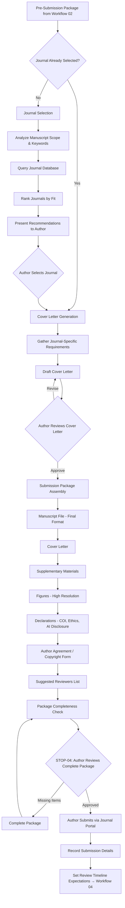

# Workflow 03: Submission

## Overview

This workflow handles journal selection, cover letter generation, and final submission package assembly. It bridges pre-submission preparation with the actual submission to a journal.

**Primary Agent**: Author Agent
**Supporting Agents**: Production Agent (package assembly)
**Quality Gates**: STOP-04 (submission package approval)

---

## Workflow Diagram

---

## Steps

### Step 1: Journal Selection
See: `journal-selection.md`

Evidence-based journal matching considering scope, impact, OA policy, turnaround time, and acceptance rate. Invokes `skills/journal-matching.md`.

### Step 2: Cover Letter Generation
See: `cover-letter.md`

Draft a journal-specific cover letter highlighting manuscript significance, relevance to journal scope, and key findings. Invokes `skills/cover-letter-drafting.md`.

### Step 3: Submission Package Assembly
See: `submission-package.md`

Assemble all required files and declarations into a complete submission package. Verify completeness against journal requirements.

### Step 4: Author Approval (STOP-04)

The author must review the complete submission package before submitting. This is a STOP gate — no automated submission.

---

## Sub-Files

| File | Purpose |
|---|---|
| `journal-selection.md` | Evidence-based journal matching |
| `cover-letter.md` | Cover letter generation |
| `submission-package.md` | Submission package assembly and verification |

---

## Skills Used

- `skills/journal-matching.md` — Journal recommendation engine
- `skills/cover-letter-drafting.md` — Cover letter generation
- `skills/ai-disclosure-drafting.md` — If additional disclosure needed for cover letter
