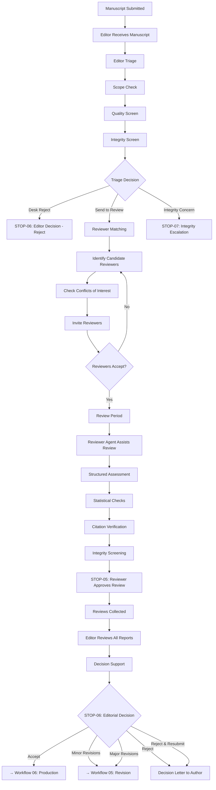

# Workflow 04: Peer Review

## Overview

This workflow supports all stakeholders in the peer review process: reviewers conducting reviews, editors triaging manuscripts and matching reviewers, and integrity screening for paper mill detection and data verification.

**Primary Agents**: Reviewer Agent, Editor Agent, Integrity Agent
**Quality Gates**: STOP-05 (review submission), STOP-06 (editorial decision), STOP-07 (integrity escalation)

---

## Workflow Diagram

---

## Steps

### Step 1: Editor Triage
See: `editor-triage.md`

Initial manuscript screening for scope alignment, basic quality, and integrity red flags. Can result in desk rejection (saves reviewer time) or progression to peer review.

### Step 2: Integrity Screening
See: `integrity-screening.md`

Dedicated integrity checks: paper mill detection (tortured phrases, suspicious metadata), image forensics, statistical consistency, and citation network analysis.

### Step 3: Reviewer Matching
See: `reviewer-matching.md`

Identify and recommend reviewers based on expertise match, publication history, availability, and conflict-of-interest screening.

### Step 4: Reviewer Assistance
See: `reviewer-perspective.md`

Assist reviewers with structured review generation, statistical checking, citation verification, and consistency analysis — while maintaining strict confidentiality.

### Step 5: Editorial Decision Support

Provide the editor with structured summaries of reviewer reports, highlighting consensus and disagreements, to support (not replace) the editorial decision.

---

## Sub-Files

| File | Purpose |
|---|---|
| `reviewer-perspective.md` | Structured review assistance for peer reviewers |
| `editor-triage.md` | Manuscript screening for editors |
| `integrity-screening.md` | Paper mill detection, image forensics, statistical checks |
| `reviewer-matching.md` | Expertise-based reviewer recommendation |

---

## Skills Used

- `skills/citation-verification.md` — Verify manuscript references
- `skills/statistical-review.md` — Check statistical methods and reporting
- `skills/plagiarism-screening.md` — Text similarity checking
- `skills/image-integrity.md` — Image manipulation detection
- `skills/readability-analysis.md` — Assess manuscript readability

---

## Critical Rules

- `rules/confidentiality.md` — ALL peer review content is confidential
- `rules/quality-gates.md` — STOP-05, STOP-06, STOP-07 are mandatory
- `rules/ai-ethics.md` — AI cannot make editorial decisions
- `rules/citation-integrity.md` — Verify manuscript citations
