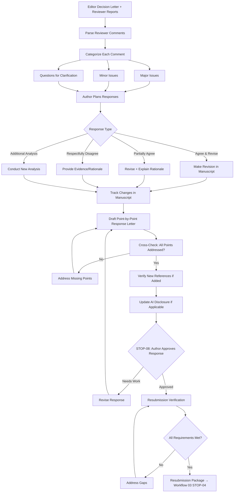

# Workflow 05: Revision

## Overview

This workflow handles the revision process after receiving reviewer feedback — from parsing reviewer comments through point-by-point response generation, revision tracking, and resubmission verification.

**Primary Agent**: Author Agent
**Quality Gates**: STOP-08 (revision response approval)

---

## Workflow Diagram

---

## Steps

### Step 1: Parse and Categorize Reviewer Comments
- Extract individual reviewer comments
- Categorize each as: major issue, minor issue, question, editorial note
- Number each comment for point-by-point tracking

### Step 2: Response Strategy
For each comment, the author decides:
- **Agree and revise**: Make the requested change
- **Partially agree**: Make a modified change with explanation
- **Respectfully disagree**: Provide evidence supporting the original approach
- **Additional work needed**: Conduct new analysis, add data, etc.

### Step 3: Point-by-Point Response
See: `response-to-reviewers.md`
- Draft a structured response addressing every single comment
- Include specific manuscript locations for all changes
- Use professional, respectful tone throughout

### Step 4: Revision Tracking
See: `revision-tracking.md`
- Track all changes in the manuscript
- Maintain a change log with locations and reasons
- Prepare both clean and tracked-changes versions

### Step 5: Resubmission Verification
See: `resubmission-check.md`
- Verify every reviewer point has a response
- Verify all promised changes are in the manuscript
- Check for new references added during revision
- Update AI disclosure if AI was used during revision

---

## Sub-Files

| File | Purpose |
|---|---|
| `response-to-reviewers.md` | Point-by-point response drafting |
| `revision-tracking.md` | Change tracking and documentation |
| `resubmission-check.md` | Final verification before resubmission |

---

## Skills Used

- `skills/response-letter-drafting.md` — Structured response generation
- `skills/citation-verification.md` — Verify any new references
- `skills/statistical-review.md` — If additional analyses conducted
- `skills/ai-disclosure-drafting.md` — Update disclosure if AI used in revision
