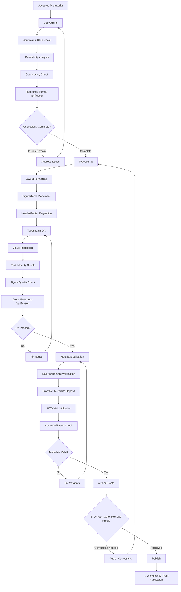

# Workflow 06: Production

## Overview

Post-acceptance production workflow covering copyediting, readability analysis, typesetting QA, and metadata validation. Ensures the final published version is polished, accessible, and accurately indexed.

**Primary Agent**: Production Agent
**Supporting Agents**: Author Agent (proof review)
**Quality Gates**: STOP-09 (final publication approval)

---

## Workflow Diagram

---

## Steps

### Step 1: Copyediting
See: `copyediting.md`

AI-assisted copyediting with readability analysis. Covers grammar, style, consistency, and accessibility while preserving technical meaning.

### Step 2: Typesetting QA
See: `typesetting-qa.md`

Quality assurance for the typeset version — layout, figures, tables, cross-references, and pagination.

### Step 3: Metadata Validation
See: `metadata-validation.md`

Verify all metadata for accurate indexing: DOI, CrossRef deposit, JATS-XML, author/affiliation data, funding information, and keywords.

### Step 4: Author Proofs (STOP-09)

The author must review and approve final proofs before publication. This is the last chance to catch errors.

---

## Sub-Files

| File | Purpose |
|---|---|
| `copyediting.md` | AI-assisted copyediting with readability analysis |
| `typesetting-qa.md` | Layout and typesetting quality assurance |
| `metadata-validation.md` | DOI, CrossRef, JATS-XML, and metadata verification |

---

## Skills Used

- `skills/readability-analysis.md` — Flesch-Kincaid, SMOG, Gunning Fog scoring
- `skills/jats-xml-conversion.md` — JATS-XML generation and validation
- `skills/citation-verification.md` — Final reference verification
