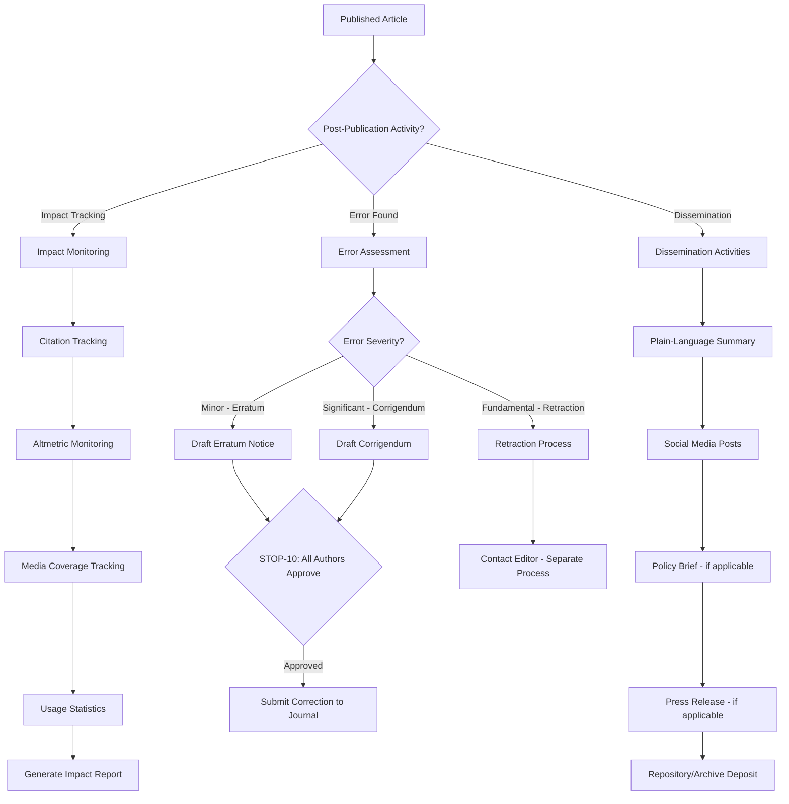

# Workflow 07: Post-Publication

## Overview

Post-publication activities including impact tracking, erratum/corrigendum management, and dissemination of research findings to broader audiences.

**Primary Agent**: Production Agent, Author Agent
**Quality Gates**: STOP-10 (erratum/corrigendum publication)

---

## Workflow Diagram

---

## Steps

### Step 1: Impact Tracking
See: `impact-tracking.md`

Monitor and report on article impact through citations, Altmetric scores, media mentions, and usage statistics.

### Step 2: Erratum/Corrigendum Management
See: `erratum-corrigendum.md`

Handle post-publication corrections, from error identification through correction notice publication. Includes STOP-10 gate for author approval.

### Step 3: Dissemination
See: `dissemination.md`

Create plain-language summaries, social media content, policy briefs, and other materials to maximize research impact and reach non-academic audiences.

---

## Sub-Files

| File | Purpose |
|---|---|
| `impact-tracking.md` | Citation and altmetric monitoring |
| `erratum-corrigendum.md` | Post-publication corrections |
| `dissemination.md` | Plain-language summaries and outreach |
